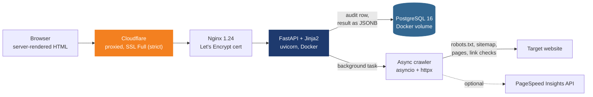

# SiteScope

**Live:** [vikramyadav.me](https://vikramyadav.me)

A free technical SEO audit tool that crawls a whole website instead of one URL, and ranks what it finds by one rule: **priority = severity × share of pages affected**. A missing alt text on every page outranks a broken link on one; a 5xx on half the site outranks both. Most free checkers stop at a single page and hand back an unordered list, so the question "what do I fix first" is left to the user. Everything else here — the crawler, the link graph, the duplicate detection — exists to give that score honest inputs.

## Architecture



One Azure VM (`Standard_B2ats_v2`, 2 vCPU, 1 GiB RAM, Central India), two containers. No Redis, no queue, no worker: an audit is a FastAPI background task, at most three run at once behind an `asyncio.Semaphore`, and the finished result is one JSONB column. No JavaScript framework either — every page, including the report, is server-rendered, because a tool that lectures people about JavaScript SEO should be readable by a crawler that runs none.

| Layer | Choice |
|---|---|
| Language | Python 3.12 |
| Web | FastAPI 0.115, Jinja2 templates, hand-written CSS with light/dark tokens |
| Crawling | asyncio + httpx 0.28, `urllib.robotparser`, XML sitemaps and sitemap indexes |
| Parsing | BeautifulSoup 4.12 |
| Analysis | NetworkX 3.4 for the link graph, own PageRank, own 64-bit SimHash |
| Data | PostgreSQL 16 via psycopg 3; in-memory store when `DATABASE_URL` is unset |
| Deploy | Docker Compose, Nginx reverse proxy, Certbot, Cloudflare DNS, UFW |
| Tests | pytest, 8 tests against a fake site on `httpx.MockTransport`. No network needed. GitHub Actions on every push |

8 SEO landing pages, a report page, a small JSON API, `robots.txt` and `sitemap.xml`. 25 issue types.

## Implemented vs planned

| | Status |
|---|---|
| Site-wide crawl: BFS by depth, robots.txt, sitemaps, rate limiting, URL normalisation | Implemented |
| On-page checks: status codes, redirect chains, noindex, titles, meta descriptions, H1, canonical, alt text, lang, thin content | Implemented |
| Broken internal and external links | Implemented — HEAD first, GET fallback, first 200 external links only |
| Internal link graph: PageRank, click depth, orphan pages | Implemented |
| Duplicate and near-duplicate pages | Implemented — SimHash on 3-word shingles, Hamming distance ≤ 3 |
| Priority score and health score | Implemented |
| SSRF guard | Implemented — see below |
| Core Web Vitals (LCP, INP, CLS) | Implemented, but the live server has no PageSpeed API key, so Google answers 429 and the report says so |
| JavaScript rendering diff | Implemented, optional — off in production; Playwright is not in the image |
| Pages per audit | Capped at 300, depth 6 |
| PDF report | Not built. The report is an HTML page with a JSON download |
| Accounts, history, scheduled re-audits | Not built |

## Decisions and problems

*What was wrong or risky, why it mattered, what it is now.*

**A server that fetches any URL a stranger types is an SSRF hole.** The obvious audit target for an attacker is not a website — it is `http://169.254.169.254/` (Azure's instance metadata service), `http://localhost:8000/`, or the Postgres container. `app/safety.py` resolves the host and refuses private, loopback, link-local and reserved addresses, and non-HTTP schemes. It runs as an httpx request hook, not once at the start, so every redirect hop is checked too — a public URL that 302s to the metadata service is stopped at the hop, not after it. A test asserts that `localhost`, `127.0.0.1`, `169.254.169.254` and `ftp://` are all refused.

**`nx.pagerank` pulled in numpy and scipy.** Two heavy dependencies for one function, on a 1 GiB VM. PageRank on a few hundred nodes is a small power iteration, so it is written out in `app/linkgraph.py` (damping 0.85, dangling pages share their rank with every page, as in Brin and Page). A test compares it against NetworkX's own pure-Python reference and requires agreement to 1e-4.

**Ranking by severity alone gets the order wrong.** A severity-3 issue on one page out of 300 is less urgent than a severity-1 issue on all of them. Multiplying by the share of pages affected fixes that, and capping each issue at 100 in the health score stops one site-wide problem from flattening the whole number to zero.

**Report pages are user-generated thin content.** Every audit creates a URL. Left indexable, an SEO tool would be generating thousands of near-identical pages on its own domain. Report pages send `noindex`, and `robots.txt` disallows `/report/` and `/api/`.

**Moving DNS could have taken down two other projects.** vikramyadav.me already served Nexora and Quadrantcode as subdomains on Vercel. Switching the nameservers to Cloudflare replaces the whole zone, so any record not recreated first stops resolving the moment the change propagates. Both CNAMEs were added in Cloudflare as DNS only (Vercel issues its own certificates and needs the traffic unproxied) and checked before the nameserver change. Quadrantcode was missing from the first copy and was caught before the switch, not after.

**SSL had to be issued before the proxy went on.** Let's Encrypt's HTTP-01 check has to reach the VM itself. Order used: records grey, wait for propagation and confirm it with `dig`, run Certbot, then turn the records orange and set Cloudflare to Full (strict) so Cloudflare verifies the origin certificate instead of trusting anything.

**The planned VM size did not exist.** B1s is not offered to Azure for Students in Central India, and B2ats_v2 is restricted in availability zones 1 and 2. The VM is B2ats_v2 with no zone, plus 1 GB of swap for the 1 GiB of RAM. Server setup is one script (`deploy/azure-setup.sh`) passed as Azure custom data, so the VM can be rebuilt from nothing.

## What's still open

- **HEAD requests return 405.** FastAPI routes are GET-only, so uptime monitors and some crawlers that send HEAD get an error on every page. The fix is a small middleware that answers HEAD like GET without a body; it is not deployed yet.
- **The SSRF guard has a DNS-rebinding gap.** The host is resolved once by the guard and again by httpx when it connects; a hostile DNS server could answer differently the second time. Closing it means pinning the connection to the IP the guard checked.
- **Core Web Vitals are empty on the live site** until a PageSpeed Insights API key is set.
- **An audit lost to a restart stays "running" forever.** Background tasks live in the app process; nothing marks orphaned rows as failed on startup.
- **No per-IP limit on starting audits.** Only concurrency is capped, at three; a fourth request waits.
- **External link checks stop at 200 links per audit.**

## What I would do next

1. **Set the PageSpeed key and mark orphaned audits failed on boot.** Both are small, and both currently make the live report look worse than the code is.
2. **Pin the resolved IP in the SSRF guard.** The current check is good against typed URLs and redirects, not against a determined attacker with their own DNS.
3. **Ship the HEAD fix.**
4. **A PDF export of the report**, since that is what people forward to a client or a manager.
5. **Saved audits and re-crawls**, so a site can be compared against its own last audit instead of judged once.

## Local setup

```bash
pip install -r requirements-dev.txt
pytest -q                                  # 8 tests, no network needed
uvicorn app.main:app --reload              # http://127.0.0.1:8000, in-memory store
```

With PostgreSQL, the way it runs in production:

```bash
cp .env.example .env                       # set POSTGRES_PASSWORD; PAGESPEED_API_KEY optional
docker compose up -d --build
curl http://127.0.0.1:8000/health
```

The test suite serves a small fake website through `httpx.MockTransport` — robots.txt with a disallowed path, a sitemap with an orphan page, a 404, a noindex page, a dead external link, two pages sharing a title and their text — and checks that each of those comes back as the right issue, that issues are sorted by priority, and that the SSRF guard holds.

## Deploying

`deploy/azure-setup.sh` turns a fresh Ubuntu 24.04 VM into the production server: packages, UFW (SSH, 80, 443), swap, Docker, the repo in `/opt/sitescope`, a random database password in `.env`, Docker Compose, and the Nginx site. Pass it as Azure custom data:

```bash
#!/bin/bash
curl -fsSL https://raw.githubusercontent.com/vikramyadav1404/sitescope/main/deploy/azure-setup.sh | bash
```

Then point DNS at the VM (DNS only), run `sudo certbot --nginx -d vikramyadav.me -d www.vikramyadav.me`, switch the records to Proxied and Cloudflare to Full (strict). `deploy/evidence.sh` prints the server facts — OS, Nginx, Docker, Postgres version, firewall, DNS, certificate expiry — without printing any secret.

## Configuration

| Variable | Default | Meaning |
|---|---|---|
| `DATABASE_URL` | empty (memory) | PostgreSQL DSN; set by Docker Compose |
| `POSTGRES_PASSWORD` | — | Database password (Compose) |
| `PAGESPEED_API_KEY` | empty | Without it Google often returns 429 |
| `SITE_URL` | `https://vikramyadav.me` | Canonical tags and sitemap |
| `MAX_PAGES` | `300` | Pages per audit |
| `CONCURRENCY` / `REQUEST_DELAY_MS` | `5` / `200` | Crawl politeness |
| `RENDER_JS` | off | `1` enables the Playwright diff (needs Playwright + Chromium) |

## API

```
POST /api/audits {"url": "example.com", "max_pages": 50} → 202 {"id", "status": "queued", "report_url"}
GET /api/audits/{id} → status and the full JSON result.
```

Interactive docs at `/api/docs`.
